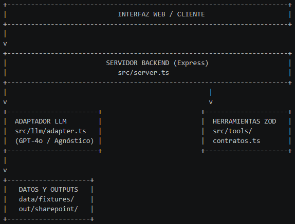

# SOLUCION.md - Reto 02: Agente de Registro y Gestión de Contratos Vigentes

**Empresa:** Periferia IT Group  
**Desarrollador / Arquitecto:** Flabio Rodríguez Correa  
**Fecha:** Octubre 2026  
**Stack Tecnológico:** Node.js v24, TypeScript 5.3, Zod 3.22, Express, OpenAiAdapter  

---

## 1. Resumen Ejecutivo
El sistema implementa un agente conversacional inteligente y determinista diseñado para automatizar el procesamiento de contratos en el buzón corporativo de Periferia IT Group. El agente extrae metadatos clave, valida información contra el archivo maestro corporativo, solicita confirmación humana ante discrepancias o baja confianza, actualiza el registro maestro y clasifica/archiva los documentos en la estructura simulada de SharePoint.

---

## 2. Arquitectura de la Solución



---

## 3. Catálogo de Herramientas Tipadas (Zod)

El sistema utiliza cinco herramientas con esquema estricto de Zod y manejo seguro de excepciones:

1. **`contratos_leer_buzon`**: Revisa los mensajes no procesados en `data/fixtures/buzon/`, identificando remite, asunto y presencia de contratos adjuntos.
2. **`contratos_extraer`**: Extrae campos clave (partes, fechas, montos, vigencias, pólizas) e indica el puntaje de confianza general.
3. **`contratos_validar`**: Determina si el contrato es nuevo, modificación/otrosí, duplicado o rechazado frente al maestro corporativo.
4. **`contratos_registrar`**: Escribe las entradas validadas en el maestro y organiza los PDFs en la estructura simulada de SharePoint (`out/sharepoint/`). Requiere bandera `confirmado: true` si hubo alertas de revisión.
5. **`contratos_alertas`**: Identifica vencimientos próximos de contratos y pólizas pendientes, consolidando el reporte en `out/alertas.md`.

---

## 4. Script de Verificación Determinista (`demo.ts`)

El script `demo.ts` permite validar la lógica de negocio completa de punta a punta sin necesidad de invocar apis de terceros ni consumir tokens de LLM. Ejecuta las 5 herramientas en secuencia sobre los mensajes reales del buzón (`msg-001` a `msg-006`).

**Comando de ejecución:**
```powershell
npm.cmd run demo

## 5. Estimación de Costos del Modelo LLM
Para un volumen estimado de 1,000 contratos mensuales procesados mediante el modelo gpt-4o:
Prompt Tokens por Contrato: ~2,500 tokens (System prompt + herramientas + extractos de texto).
Completion Tokens por Contrato: ~500 tokens (Estructura JSON de respuesta + llamada a herramienta).
Costo por 1k Entrada (GPT-4o): $0.0025 USD
Costo por 1k Salida (GPT-4o): $0.0100 USD
Costo mensual estimado = $11.25 USD/mes

## 6. Regla de Gobierno y Seguridad Corporativa
REGLA DE GOBIERNO:
 Cero Alucinaciones: Toda información registrada debe provenir exclusivamente de los outputs devueltos por las herramientas de consulta y extracción.
 Intervención Humana Obligatoria (Human-in-the-loop): Todo contrato con un nivel de confianza inferior a 0.80, o clasificado como "modificación con discrepancias", requiere validación y aprobación explícita por parte de la analista administrativa previa a la ejecución de contratos_registrar.
 Seguridad e Inmutabilidad: Los archivos originales del buzón (data/fixtures/) deben ser tratados como de solo lectura. Ninguna herramienta puede alterar o eliminar los correos originales.

## 7. Despliegue en Infraestructura Hostinger (Plan Business)
El backend de la aplicación Node.js está listo para desplegarse en Hostinger Business Web Hosting:
Configuración de Node.js en hPanel: Seleccionar Node.js versión 20.x o superior en el panel de control de Hostinger.
Variables de Entorno: Configurar en el panel de administración las variables PORT, OPENAI_API_KEY y OPENAI_MODEL.
Repositorio Git: Conectar el repositorio de GitHub para despliegue automático continuo.
Comando de Inicio: npm start (ejecutando tsx src/server.ts).

